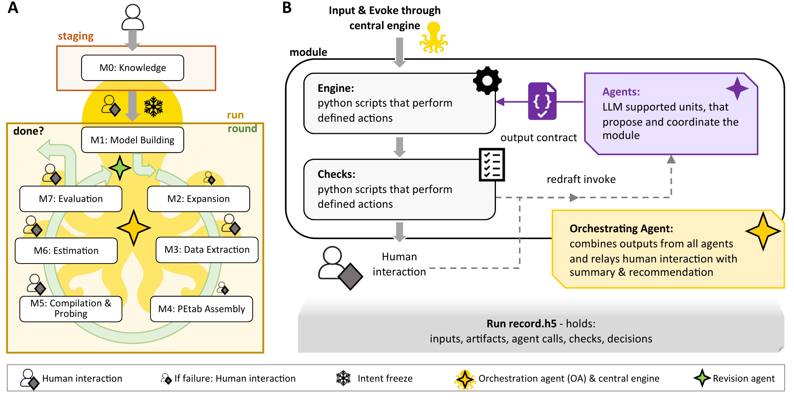
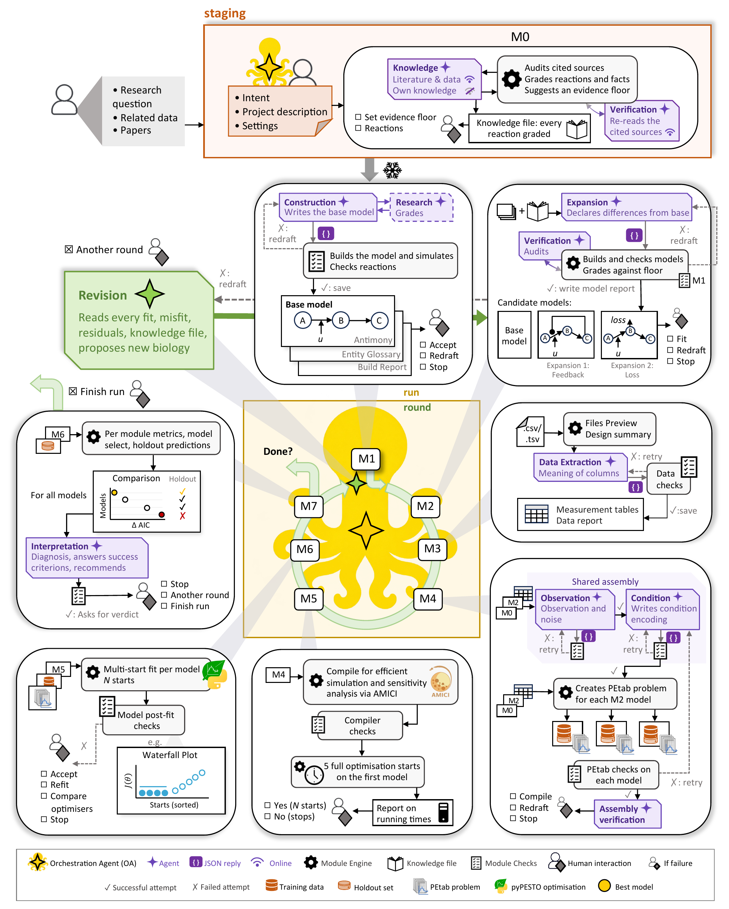

# Octomod - mechanistic modelling with LLM agents and established workflows

Octomod builds mechanistic ODE models of your own measurements with you. You
bring the data and the question. Large language model (LLM) agents, run through
Claude Code, retrieve what is known, propose the model and its candidates, and
read the misfits. A deterministic engine checks every proposal, builds the
models in SBML and PEtab, fits them with pyPESTO and AMICI, and compares them.
You decide at defined interaction points, wherever the model's scope, cost or
verdict is at stake. Every input, model, check, agent call and decision is kept
in one file, the run record.



*The workflow (A) and one module (B): agents propose, the module engine builds
and checks, you decide at interaction points, and every step goes into the run record.*

## Feature overview

Octomod features include:

* **Agents propose, engines check.** LLM agents, run through
  [Claude Code](https://claude.com/claude-code), retrieve what is known, write the
  model and its candidates, link the model to the data, and read the misfits.
  Every proposal has to pass defined checks before it is used.
  ([what each agent is shown](docs/ROUTING.md),
  [what an agent can reach](docs/PERMISSIONS.md))
* **Eight workflow modules**, from the knowledge module (M0) to evaluation (M7),
  with a revision step between rounds. Each module has a deterministic module
  engine, its agents and its checks.
  ([the modules](octomod/workflow_modules/README.md))
* **Established standards and tools**: models in [SBML](https://sbml.org/) and
  [PEtab](https://github.com/PEtab-dev/PEtab), simulation with
  [AMICI](https://github.com/AMICI-dev/AMICI/), parameter estimation with
  [pyPESTO](https://github.com/ICB-DCM/pyPESTO), model selection with
  [PEtab Select](https://github.com/PEtab-dev/petab_select). The resulting files
  can be used without Octomod.
* **Graded prior knowledge.** Every reaction of a model carries its literature
  sources and an evidence grade, and you set the evidence floor a reaction needs.
  ([the knowledge module](octomod/workflow_modules/knowledge/README.md))
* **Your decision at defined interaction points**: the intent, the model
  candidates, the compile, the estimation budget, convergence problems, the
  verdict, and every further round.
  ([the orchestration](octomod/orchestration/README.md))
* **One run record per run.** Every input, model, check, agent call and decision
  is kept in one HDF5 file, with HTML reports beside it.
  ([the record](docs/RESULT-SCHEMA.md))
* **Four applications** from the publication, ready to rerun.
  ([examples](examples/README.md))

This is the software of the paper cited [below](#how-to-cite). The run records,
models, results and figure scripts of its four applications are on Zenodo
([doi:10.5281/zenodo.24147167](https://doi.org/10.5281/zenodo.24147167)); the
problems are in [`examples/`](examples/).

## Setup (once)

You need:

- [uv](https://docs.astral.sh/uv/)
- a C++ compiler: on macOS `xcode-select --install`; on Linux `build-essential`
  and `libhdf5-dev`
- graphviz, for the figures in the reports: `brew install graphviz` or
  `apt-get install graphviz`
- Claude Code (the `claude` command), logged in in the terminal: `claude auth login`.
  `claude auth status` shows whether the login is still valid. The live agents
  run through this command, so a login that has expired stops a live run.
- The first time you open this folder in Claude Code, accept the trust dialog.
  The project's permission rules (`.claude/settings.json`) apply only after that.

Then:

```bash
git clone https://github.com/ICB-DCM/Octomod.git
cd Octomod
uv sync
```

The first `uv sync` takes a few minutes: it creates `.venv/` from the committed
`uv.lock` and compiles AMICI. If you use Claude Code's sandbox, run `uv sync`
yourself in a terminal before you start Claude: uv keeps its package cache
outside the project folder, where a sandboxed command cannot write. A
token-free check that the install works (it writes two small records into
`runs/`):

```bash
uv run python tests/golden_path.py toy_phos toy_decay_params
```

## Using it

1. **Put your data in `staging/`.** Your measurement files are CSV or TSV.
   Claude reads nothing outside the repository folder (a setting in
   `.claude/settings.json`), so put the files into `staging/<name>/data/`
   before you start.

2. **Start Claude in the repository folder** and describe your problem: what
   you measured and what you want to know.

   ```bash
   claude
   ```

   Claude, the paper's orchestrating agent, reads [`CLAUDE.md`](CLAUDE.md) on
   its own. It writes `description.md`, `intent.yaml` and `testcase.yaml` (with
   the held-out conditions) with you, runs the knowledge module (M0) once you
   agree, and starts the run after you have set the evidence floor and frozen
   the intent. A run with the real agents (`--backend llm`) costs money; Claude
   asks before every live launch and gives the projected cost before each estimation.

3. **Answer the questions it relays.** You set the evidence floor before the
   run. The workflow then stops at its interaction points: the intent, the
   model candidates, the compile, the estimation budget, convergence problems,
   the verdict, and every further round. Claude never answers one for you.
   Instructions you give it in advance are relayed and recorded as your
   answers, and a declared gate policy (`--policy`) as the policy's.

4. **Read the results.** `runs/<id>_reports/ANALYSIS.html` is the run's report,
   with one report per round beside it. `./run.sh show --run-id <id>` and
   `./run.sh explore --run-id <id>` read the run record, `runs/<id>.h5`.
   A model's SBML and PEtab tables are kept only in the record and come out
   one part at a time, for example a model candidate's SBML with
   `./run.sh show --run-id <id> rounds/round_0/candidates/<candidate>/model/sbml --full > model.xml`
   (in a run with one model, `rounds/round_0/model/sbml`;
   [the record keys](octomod/result/README.md)).

## How it works

Each workflow module has a module engine, deterministic code that calls the
module's agents, builds, checks and records. Each agent is a separate Claude
Code call without memory; it sees only the context declared for it
([`docs/ROUTING.md`](docs/ROUTING.md)) and replies in a declared format. A reply
that fails a check goes back to the agent; after 3 failures, you are asked.



*Staging with M0 until the intent is frozen, then rounds of M1 to M7 (later
rounds start at M2), each module with its agents, checks and interaction points.*

## The modules

| module | what it does | agents | folder |
|---|---|---|---|
| M0 knowledge | finds the reactions and facts known for the system, with sources; grades each reaction and suggests the evidence floor, below which a reaction is flagged | `knowledge`, `knowledge_verification` | [`knowledge/`](octomod/workflow_modules/knowledge/README.md) |
| M1 model building | writes the base model in Antimony, converts it to SBML and checks it by simulation | `construction`, `research` | [`model/`](octomod/workflow_modules/model/README.md) |
| M2 model expansion | proposes mechanisms to add to the base model; the module engine builds the model candidates from them | `expansion`, `construction_verification` | [`model/`](octomod/workflow_modules/model/README.md) |
| M3 data extraction | says what each column of the data files holds; the module engine converts the files to PEtab, so no agent can alter a measurement | `data_extraction` | [`data/`](octomod/workflow_modules/data/README.md) |
| M4 PEtab assembly | writes the observables, the noise model and the conditions; the module engine assembles and checks one PEtab problem per candidate | `observation`, `condition`, `assembly_verification` | [`assembly/`](octomod/workflow_modules/assembly/README.md) |
| M5 compilation and probing | compiles each candidate with AMICI and projects the estimation time from 5 starts | none | [`cost_probe/`](octomod/workflow_modules/cost_probe/README.md) |
| M6 parameter estimation | multi-start optimisation with pyPESTO (by default 100 starts with Fides), then convergence checks | none | [`estimation/`](octomod/workflow_modules/estimation/README.md) |
| M7 evaluation | compares the candidates by AIC and on held-out data, characterises the misfit, and interprets the result against the success criteria | `interpretation` | [`evaluation/`](octomod/workflow_modules/evaluation/README.md) |
| revision | proposes the changes for the next round from the fits, the misfit and the knowledge file | `revision`, `revision_proposal` | [`revision/`](octomod/workflow_modules/revision/README.md) |

- [`octomod/workflow_modules/intent/`](octomod/workflow_modules/intent/README.md) checks the intent at the start of a run, where you freeze it.
- `octomod/orchestration/` is the central engine (the orchestrator, in the code): it runs the modules in order, stops at each interaction point, and resumes a paused run.
- [`octomod/gates/`](octomod/gates/README.md) holds part of the checks, which run without an LLM apart from two advisory audits by an agent; its README says where the others are. In the code both a check and an interaction point are called a gate: a check is a gate the engine evaluates, an interaction point is a gate a person answers (`--gate-answer`).
- `octomod/result/` writes the run record and validates it against its record classes, from which [`docs/RESULT-SCHEMA.md`](docs/RESULT-SCHEMA.md) is generated.

## The paper's examples

[`examples/`](examples/) holds the four problems of the paper as the runs
received them: the description, the intent, the staged settings
(`testcase.yaml`), the data, and the knowledge module's output where used. To
rerun one, copy it into `staging/`.

| folder | paper | what the run did |
|---|---|---|
| `examples/ctd/` | Results 1 | CTD phosphorylation by P-TEFb, 36 mass spectrometry values, no knowledge module, no information added at any interaction point; two rounds |
| `examples/macrophage/` | Results 2 | IFN-γ response of human macrophages, four transcripts, 81 arrays; supplied literature, interactive refinement over five rounds |
| `examples/macrophage_recalibration/` | Results 2 | the second macrophage run, started from the recalibrated model of the first |
| `examples/pbmc/` | Results 3 | pSTAT1/3/5 of five PBMC cell types under seven stimuli, 840 values; online knowledge module; 16 models in five rounds (a 17th fitted outside the run) |
| `examples/sphingolipid/` | Results 4 | pulse-chase lipidomics of SH-SY5Y cells with a supplied model; the first of six runs |

For example, the CTD problem (which runs without the knowledge module, by its
`testcase.yaml`):

```bash
cp -r examples/ctd staging/ctd
claude          # "run the staged problem ctd"
# or without the conversation, answering each interaction point at the terminal:
./run.sh run --testcase staging/ctd --backend llm --run-id ctd_rerun
```

A rerun uses `workflows/default.yaml` as committed; each original run's model,
effort and settings are in its record. The agents' replies will differ from the
original runs, which are on Zenodo with every reply. An example with a
`knowledge/` folder starts from that knowledge file; delete the folder to run
the knowledge module again:
`./run.sh knowledge --testcase staging/<name> --mode online --backend llm`.

## Documentation

* [Getting started](docs/site/getting-started.md): install, stage your own
  problem, run it, and the decisions that are yours.
* [A real run, start to finish](docs/site/index.md): the documentation site walks
  through the CTD application, built from its run record. Build it with
  `uv sync --group docs` and
  `uv run --group docs sphinx-build -W docs/site docs/site/_build/html`.
* [The workflow modules](octomod/workflow_modules/README.md), with one page per
  module.
* [`CLAUDE.md`](CLAUDE.md): the instructions of the orchestrating agent, with
  the commands it uses. `./run.sh <command> --help` lists every option.

## Repository layout

| path | what |
|---|---|
| `octomod/` | the package: [`workflow_modules/`](octomod/workflow_modules/README.md), [`orchestration/`](octomod/orchestration/README.md) (the central engine), [`agents/`](octomod/agents/README.md), [`gates/`](octomod/gates/README.md) (checks), [`result/`](octomod/result/README.md) (the run record), [`reporting/`](octomod/reporting/README.md), [`connectors/`](octomod/connectors/README.md) |
| `skills/` | one prompt template per agent |
| `.claude/` | the orchestrating agent's skills and the permission settings |
| [`workflows/`](workflows/README.md) | the settings of a run: every threshold and budget |
| [`knowledge/`](knowledge/README.md) | domain packs, advice given to some agents |
| `examples/` | the four applications of the publication |
| `staging/`, `runs/` | your problems and your runs; their contents are not committed |
| [`tests/`](tests/README.md), `testcase/` | the test battery, and the prepared problems it runs on |
| [`tools/`](tools/README.md), `docs/` | developer scripts; the reference pages and the documentation site |

## Contributing

We are happy about any contribution. The test battery runs without spending
anything (169 suites, 16 of them at full effort); how to run it, and how to run
the workflow without Claude, is in [`tests/README.md`](tests/README.md).

## How to cite

When using Octomod in your project, please cite

* Dorešić, D., Liu, Y., Wieland, V., Jost, P. J., Huth, M., Merkt, S.,
  Alvarez-Garavito, C., Moore Dillems, P. R., Thiele, C., Seep, L., Pathirana, D.,
  & Hasenauer, J. Large language models complement established workflows for
  mechanistic model construction and refinement in systems biology. bioRxiv, 2026
  (the doi is added on posting).

[`CITATION.cff`](CITATION.cff) has the citation in machine-readable form.

## Licence and contact

BSD 3-Clause, see [`LICENSE`](LICENSE). Domagoj Dorešić
(domagoj.doresic@uni-bonn.de), Jan Hasenauer (jan.hasenauer@uni-bonn.de),
University of Bonn.
