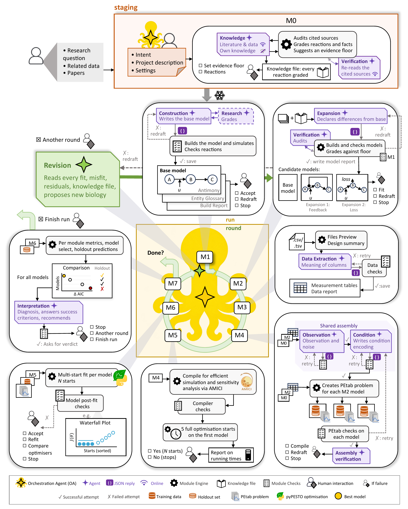

# The workflow modules

One folder per step of a run: the intent, the eight workflow modules M0 to M7 (M1 and M2 share
`model/`), and the revision. In each, `engine.py` is the module engine, the deterministic code that
calls the module's agents, builds, checks and records. Each folder has a README: what the module
does, its agents, where it asks you, and what it writes.

*The Octomod workflow in detail. Figure taken from the publication.*

## Names of the steps

| step | folder | `--from-module` | marker in the record | label in the code |
|---|---|---|---|---|
| the intent, frozen before the first round | [`intent/`](intent/README.md) | none | none | S0 |
| M0 knowledge | [`knowledge/`](knowledge/README.md) | none | none | none |
| M1 model building, M2 model expansion | [`model/`](model/README.md) | `model` (or `s1`, `construction`) | `s1` | S1 |
| M3 data extraction | [`data/`](data/README.md) | `data` (or `s2`) | `s2` | S2 |
| M4 PEtab assembly | [`assembly/`](assembly/README.md) | `assembly` (or `s3`, `petab`) | `s3`, `candidate_compile` | S3 |
| M5 compilation and probing | [`cost_probe/`](cost_probe/README.md) | `estimation` (or `cost`) | `cost` | none |
| M6 parameter estimation | [`estimation/`](estimation/README.md) | `estimation` (or `s6`) | `s6` | S6 |
| M7 evaluation | [`evaluation/`](evaluation/README.md) | `evaluation` (or `s7`, `profiling`, `report`) | `s7` | S7 |
| revision | [`revision/`](revision/README.md) | none | none | S11 |

A module writes its marker into the record when it is done, that is, when its checks passed (or, at
M6, you accepted a failed one) and the card that ends it was approved (the scope card for `s1`,
written by M1 and M2 together; the compile card for `candidate_compile`; the budget card for `cost`;
the verdict for `s7`). The next module refuses to start without it; `./run.sh status` prints the
markers of each round. Entering at `estimation` asks the compile card again and runs M5 and M6
again. The labels S0 to S11 are the code's numbering of the same steps, used in the terminal banners
of a run with one model, in stop messages, in comments of `workflows/default.yaml`, in the help of
`./run.sh run` and `./run.sh report`, in docstrings, and in `docs/RESULT-SCHEMA.md` and
`docs/REPORTING.md`; S4, S5 and S8 to S10 do not occur. The code's side of this table is in
[`../orchestration/round_status.py`](../orchestration/round_status.py) (`SLOTS`, `MODULES`,
`MODULE_ALIASES`). M1 to M5 also label the sections of the model report, and the CTD walkthrough of
the documentation site uses them as names of model candidates; there they are not modules.

The modules are run in order by the central engine, in [`../orchestration/`](../orchestration/README.md).
The checks they use run without an LLM, apart from two advisory audits by an agent;
[`../gates/`](../gates/README.md) holds the checks of model building, PEtab assembly and estimation
and says where the others are.

## Words

- **check**: deterministic code that tests a proposal or what the engine built from it, and passes or
  fails. **Interaction point**: a place where the run stops for a person's answer. In the code both
  are called a gate: a check is a gate the engine evaluates, an interaction point is a gate a person
  answers (`--gate-mode`, `--gate-answer`, `--gate-note`, and "human gate" in the command-line help).
- **card**: what an interaction point shows: the question, the evidence, what `y` and `n` lead to,
  the forms a note may use, and the documents to read. A **failure point** is the card a module shows
  when a check keeps failing (`<module>_redraft_budget`).
- **evidence floor**: the lowest grade of evidence a reaction needs; below it a reaction is flagged,
  and in strict mode (advisory is the default) kept out of the base model. You set it as
  `support_floor` in the `grounding:` block of `testcase.yaml`, and the command-line help calls it
  the support floor. In a run with several model candidates, each further round lowers it by
  `floor_step` bands.
- **expansion floor**: the floor at which the M2 `expansion` agent's candidates may add a reaction,
  the base model's floor lowered by `grounding.variants_offset` bands (1 by default). The code and
  `docs/ROUTING.md` call it the variants' floor (`variants_floor`).
- **knowledge file**: `knowledge/knowledge.json` in the staging folder, what the knowledge module
  found; in the run record it is `rounds/round_0/reaction_evidence`. The code and some documents
  call it the dossier, a word the code also uses for an agent's earlier attempts and the checks they
  failed (`agent_calls/<role>/dossier`).
- **project description**: `description.md` in the staging folder, the experiment in your words.
  Agents receive it as `experiment_description`, and the prompt templates call it the lab note.
- **expansion**: two things. The M2 agent `expansion` writes the model candidates of a mechanism
  discrimination as differences from the base model. In a run with several model candidates, the
  revision step's proposal for the next round is also called an expansion: it is recorded at
  `rounds/round_<k>/expansion`, its card asks "Buy this expansion and run another selection round?",
  the settings call that round an expansion round, and some documents call the `revision` agent the
  expansion agent.
